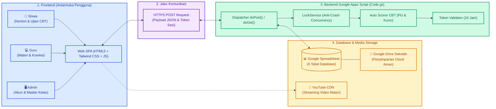

# 🎓 EduSmart LMS — Panduan Lengkap & Arsitektur Sistem

> **Sistem Manajemen Pembelajaran Digital Sekolah (LMS)** yang modern, ringan, interaktif, dan **100% Serverless** — memanfaatkan ekosistem **Google Apps Script** dan **Google Spreadsheet** sebagai basis data terpadu tanpa biaya sewa server bulanan.

---

## 📌 Daftar Isi
1. [🚀 Cara Deploy Online Gratis: GitHub & Vercel](#-cara-deploy-online-gratis-github--vercel)
2. [💡 Sekilas Tentang LMS](#-sekilas-tentang-lms)
3. [🖼️ Infografis & Arsitektur Stack](#-infografis--arsitektur-stack)
4. [🛠️ Stack Teknologi yang Digunakan](#-stack-teknologi-yang-digunakan)
5. [📂 Struktur File Proyek](#-struktur-file-proyek)
6. [📊 Skema 6 Tabel Basis Data (Google Sheets)](#-skema-6-tabel-basis-data-google-sheets)
7. [⚙️ Panduan Menghubungkan Backend (Google Apps Script)](#-panduan-menghubungkan-backend-google-apps-script)
8. [👥 Panduan Penggunaan Berdasarkan Peran](#-panduan-penggunaan-berdasarkan-peran)
9. [💡 Tips & Troubleshooting untuk Guru](#-tips--troubleshooting-untuk-guru)

---

## 🚀 Cara Deploy Online Gratis: GitHub & Vercel

Agar aplikasi LMS ini dapat diakses secara online oleh guru dan siswa dari rumah atau sekolah melalui tautan web resmi (contoh: `https://lms-sekolah.vercel.app`), Anda dapat mengunggahnya ke **GitHub** dan menghubungkannya ke **Vercel** secara **100% Gratis dan Tanpa Kartu Kredit**.

### 1. Membuat Repositori di GitHub (Create GitHub Repository)
1. Buka situs [github.com](https://github.com) dan masuk (*Sign In*) ke akun Anda. Jika belum memiliki akun, daftar gratis melalui tombol *Sign Up*.
2. Klik ikon tambah (**+**) di pojok kanan atas, lalu pilih **New repository**.
3. Isi informasi repositori:
   - **Repository name:** `lms-sekolah` (atau nama lain sesuai nama sekolah Anda).
   - **Visibility:** Pilih **Public** (wajib untuk hosting gratis Vercel tanpa konfigurasi rumit).
   - Biarkan opsi *"Add a README file"* **tidak dicentang** (karena kita sudah memiliki file lokal).
4. Klik tombol hijau **Create repository**.
5. Buka Terminal / Git Bash di folder proyek komputer Anda (`LMS_Gurus`), lalu jalankan perintah berikut secara berurutan:
   ```bash
   git init
   git add .
   git commit -m "feat: inisialisasi awal LMS sekolah"
   git branch -M main
   git remote add origin https://github.com/USERNAME_ANDA/lms-sekolah.git
   git push -u origin main
   ```
   *(Ganti `USERNAME_ANDA` dengan username GitHub Anda. Seluruh file seperti `index.html`, `styles.css`, `app.js`, `Code.gs`, dan `architecture-stack.svg` kini telah tersimpan di cloud GitHub).*

---

### 2. Publikasi Web Gratis di Vercel (Create Vercel Project)
1. Kunjungi situs [vercel.com](https://vercel.com).
2. Klik **Sign Up** atau **Log In**, lalu pilih opsi **Continue with GitHub**. Berikan izin otorisasi saat diminta.
3. Di halaman Dashboard Vercel, klik tombol **Add New...** di kanan atas > pilih **Project**.
4. Pada bagian *"Import Git Repository"*, Anda akan melihat repositori `lms-sekolah` yang baru saja dibuat. Klik tombol **Import** di samping nama repositori tersebut.
5. Pada menu konfigurasi (*Configure Project*):
   - **Project Name:** Biarkan nama default (misal: `lms-sekolah`).
   - **Framework Preset:** Pilih opsi **Other**.
   - **Root Directory:** `./` (default).
   - *Build and Output Settings:* Tidak perlu diubah karena proyek ini murni HTML5, CSS, dan JS statis.
6. Klik tombol biru **Deploy**.
7. Tunggu sekitar 20-30 detik hingga proses deployment selesai dan muncul animasi konfeti 🎉 *"Congratulations!"*.
8. Klik tombol **Visit** atau klik tautan domain yang diberikan Vercel (misal: `https://lms-sekolah.vercel.app`).
9. **Selesai!** LMS Anda kini sudah aktif di internet dengan protokol aman HTTPS (SSL gratis) dan siap dibagikan ke siswa maupun guru.

> **Keunggulan CI/CD Otomatis Vercel:**  
> Setiap kali Anda melakukan perubahan kode di komputer dan menjalankan `git push`, Vercel akan **secara otomatis memperbarui situs web dalam hitungan detik** tanpa perlu upload manual lagi!

---

## 💡 Sekilas Tentang LMS

LMS dirancang khusus untuk kebutuhan sekolah dan guru. Platform ini menyelesaikan tantangan umum pembelajaran digital:
- **Nol Biaya Server:** Tidak memerlukan langganan VPS, cPanel, atau hosting berbayar.
- **Data Milik Penuh Sekolah:** Semua data siswa, materi, dan nilai tersimpan aman di akun Google Drive sekolah.
- **CBT Otomatis & Esai:** Soal Pilihan Ganda dikoreksi langsung oleh sistem.
- **Streaming Video Lancar:** Memanfaatkan integrasi YouTube sehingga video pembelajaran tidak membebani kapasitas hosting atau kuota server lokal.
- **Responsif di Semua Gawai:** Siswa dapat belajar dan ujian dari HP Android/iPhone, tablet, maupun komputer laboratorium sekolah.

---

## 🖼️ Infografis & Arsitektur Stack

Berikut adalah gambaran visual alur kerja sistem dari perangkat pengguna hingga penyimpanan data di Google Workspace:


### 🔄 Diagram Alur Kerja Sistem (Mermaid Flowchart)



---

## 🛠️ Stack Teknologi yang Digunakan

| Lapisan (Layer) | Teknologi | Fungsi & Peran |
| :--- | :--- | :--- |
| **Frontend Markup** | **HTML5 Semantik (SPA)** | Kerangka tampilan berkonsep *Single Page Application*, pergantian halaman mulus tanpa reload. |
| **Styling & Desain** | **Tailwind CSS + Custom CSS (`styles.css`)** | Tata letak responsif, kartu *glassmorphism*, tipografi modern Plus Jakarta Sans, dan animasi transisi. |
| **Ikonografi & Visual** | **Lucide Icons** | Ikon visual yang konsisten, bersih, dan intuitif untuk navigasi guru dan siswa. |
| **Logika Klien (Script)** | **Vanilla JavaScript ES6+ (`app.js`)** | Manajemen state lokal, komunikasi Fetch API, router view, dan *Session Persistence* (`localStorage`). |
| **Backend & Controller** | **Google Apps Script (`Code.gs`)** | Serverless controller di Google Cloud: memproses login, routing API, validasi token, dan kalkulasi nilai CBT. |
| **Proteksi Transaksi** | **GAS LockService** | Mengunci proses simpan data selama milidetik untuk mencegah konflik data saat puluhan siswa submit ujian secara bersamaan. |
| **Basis Data (Database)** | **Google Spreadsheet** | Tabel relasional untuk menyimpan pengguna, materi, bank soal, dan hasil evaluasi. |
| **Media Hosting Video** | **YouTube Embed API** | Streaming video modul pembelajaran langsung di web tanpa iklan distraksi dan bebas biaya penyimpanan video. |

---

## 📂 Struktur File Proyek

Proyek ini telah dipisahkan secara modular agar mudah dibaca dan dikembangkan:

```
LMS_Gurus/
├── index.html              # Antarmuka utama (Landing page, halaman Login, & Dashboard 3 Role)
├── styles.css              # File CSS khusus (Glassmorphism, animasi fadeIn, scrollbar kustom)
├── app.js                  # Logika aplikasi (State, pemanggilan API, auth, dan navigasi peran)
├── Code.gs                 # Kode backend Google Apps Script untuk ditaruh di Google Spreadsheet
├── architecture-stack.svg  # Diagram infografis arsitektur teknologi LMS
└── README.md               # Dokumentasi panduan lengkap bagi guru dan pengembang
```

---

## 📊 Skema 6 Tabel Basis Data (Google Sheets)

Ketika fungsi `setupDatabase()` pada `Code.gs` dijalankan, Google Spreadsheet akan secara otomatis membuat 6 sheet relasional berikut:

1. **`users`**: Menyimpan identitas akun sekolah.
   - Kolom: `id_user`, `username`, `password`, `nama_lengkap`, `role`, `kelas`, `jurusan`, `created_at`
2. **`master_kelas_jurusan`**: Daftar pilihan tingkat kelas dan peminatan kejuruan.
   - Kolom: `id_master`, `tipe`, `nama`
3. **`materi`**: Modul pembelajaran yang dibuat oleh guru.
   - Kolom: `id_materi`, `id_guru`, `nama_guru`, `mapel`, `kelas`, `jurusan`, `judul_materi`, `deskripsi`, `youtube_url`, `created_at`
4. **`soal`**: Bank soal evaluasi terhubung ke ID materi.
   - Kolom: `id_soal`, `id_materi`, `nomor_urut`, `tipe_soal`, `pertanyaan`, `opsi_a`, `opsi_b`, `opsi_c`, `opsi_d`, `opsi_e`, `kunci_pg`, `bobot_poin`
5. **`jawaban_siswa`**: Rekapitulasi lembar submit ujian dan nilai.
   - Kolom: `id_submit`, `id_materi`, `id_siswa`, `nama_siswa`, `kelas`, `jurusan`, `detail_jawaban`, `skor_pg`, `skor_esai`, `total_nilai`, `status_koreksi`, `catatan_guru`, `waktu_submit`
6. **`sessions`**: Token autentikasi untuk sesi login aman pengguna (berlaku 24 jam).
   - Kolom: `token`, `id_user`, `role`, `expired_at`

---

## ⚙️ Panduan Menghubungkan Backend (Google Apps Script)

Bagi Guru atau Staf IT Sekolah yang ingin mengaktifkan LMS ini dari awal, ikuti 5 langkah mudah berikut:

### Langkah 1: Buat Google Spreadsheet Baru
1. Buka peramban (browser) dan ketik alamat: **[sheets.new](https://sheets.new)**.
2. Beri nama spreadsheet Anda, misalnya: `Database LMS Sekolah 2026`.

### Langkah 2: Buka Google Apps Script
1. Pada menu bar Spreadsheet, klik **Ekstensi** > **Apps Script**.
2. Hapus semua teks bawaan yang ada di editor kode (`function myFunction() { ... }`).

### Langkah 3: Tempel Kode `Code.gs` & Jalankan Setup
1. Salin seluruh isi file **`Code.gs`** dari proyek ini dan tempelkan ke editor Apps Script.
2. Di bagian atas editor, pastikan fungsi yang terpilih adalah **`setupDatabase`**.
3. Klik tombol **Jalankan (Run)** bertanda panah play ▶️.
4. Saat pertama kali dijalankan, Google akan meminta izin akses (*Review Permissions*):
   - Pilih akun Google Anda.
   - Klik **Advanced** (*Lanjutan*) > Klik **Go to Untitled project (unsafe)**.
   - Klik **Allow** (*Izinkan*).
5. Kembali ke Google Spreadsheet Anda. Anda akan melihat ke-6 sheet (`users`, `master_kelas_jurusan`, `materi`, `soal`, `jawaban_siswa`, `sessions`) telah otomatis terbuat lengkap dengan data awal pengujian.

### Langkah 4: Publikasikan sebagai Web App (Deployment)
1. Di halaman Apps Script, klik tombol biru **Terapkan (Deploy)** di sudut kanan atas > pilih **Deployment baru (New deployment)**.
2. Pada jenis deployment (ikon gerigi ⚙️), pilih **Aplikasi Web (Web app)**.
3. Konfigurasikan pengaturan berikut:
   - **Deskripsi:** `Produksi LMS v2.0`
   - **Jalankan sebagai (Execute as):** `Saya (email Anda)`
   - **Yang memiliki akses (Who has access):** **`Siapa saja (Anyone)`** *(Wajib dipilih agar siswa & guru dapat mengakses API).*
4. Klik **Terapkan (Deploy)**.
5. Salin **URL Aplikasi Web** yang berakhiran `/exec` (misal: `https://script.google.com/macros/s/AKfycb.../exec`).

### Langkah 5: Hubungkan ke File `app.js`
1. Buka file **`app.js`** di proyek Anda.
2. Cari variabel `const GAS_WEBAPP_URL` di baris sekitar 230:
   ```javascript
   const GAS_WEBAPP_URL = 'TEMPEL_URL_WEB_APP_ANDA_DI_SINI/exec';
   ```
3. Simpan file. Selesai! Kini aplikasi LMS Anda telah terhubung secara penuh ke basis data Google Spreadsheet sekolah.

---

## 👥 Panduan Penggunaan Berdasarkan Peran

### 1. 🎓 Siswa (Peserta Didik)
- **Akun Demo Bawaan:** NIS: `2026001` | Kata Sandi: `siswa123`
- **Alur Belajar:**
  1. Masuk menggunakan NIS dan kata sandi.
  2. Pada beranda, materi yang tampil otomatis tersaring sesuai kelas & jurusan siswa (misal: Kelas XII RPL).
  3. Klik kartu materi untuk membuka modal belajar interaktif.
  4. Tonton video materi YouTube langsung di dalam aplikasi.
  5. Selesaikan latihan soal di bawah video (Pilihan Ganda A-E & Esai uraian).
  6. Klik **Kirim Jawaban**. Skor Pilihan Ganda langsung keluar otomatis, dan status tugas akan berubah menjadi *"Menunggu Koreksi Esai"* atau *"Selesai"*.

### 2. 👨‍🏫 Guru (Pendidik)
- **Akun Demo Bawaan:** NIP: `19850412` | Kata Sandi: `guru123`
- **Fitur Utama:**
  1. **Buat Materi Baru:** Masukkan mata pelajaran, target kelas, jurusan, judul materi, petunjuk tugas, dan link video YouTube.
  2. **Kelola Bank Soal CBT:** Klik tombol *Kelola Soal* pada materi terkait untuk menambah soal Pilihan Ganda (dengan opsi A-E & kunci jawaban) atau soal esai berbobot nilai.
  3. **Meja Koreksi Jawaban Siswa:** Buka tab *Meja Koreksi* untuk melihat lembar jawaban siswa per materi, menginput nilai esai subjektif, dan memberikan catatan evaluasi atau motivasi bagi siswa.

### 3. 🛡️ Administrator Sekolah
- **Akun Demo Bawaan:** Username: `admin` | Kata Sandi: `admin123`
- **Fitur Utama:**
  1. **Manajemen Akun:** Menambah akun Guru atau Siswa baru secara individual dengan verifikasi kelas dan jurusan.
  2. **Pengaturan Master Data:** Menambah tingkatan kelas baru (misal: X, XI, XII) serta program keahlian/jurusan (RPL, TKJ, IPA, IPS, Akuntansi, dll.).
  3. **Monitoring Sistem:** Memantau ringkasan total pengguna, materi yang diterbitkan, dan keutuhan struktur database.

---

## 💡 Tips & Troubleshooting untuk Guru

### 1. Sesi Login Tidak Hilang Saat Browser Direfresh
Aplikasi telah dilengkapi fitur **Session Persistence** menggunakan `localStorage`. Ketika guru atau siswa merefresh browser (`F5`), sesi login tidak akan keluar dan dashboard tetap terbuka secara otomatis. Untuk berganti akun, cukup klik tombol merah **Keluar**.

### 2. Cara Mencetak Rekap Nilai ke Excel atau PDF
Karena semua nilai tersimpan di Google Spreadsheet sekolah Anda:
1. Buka Google Spreadsheet `Database LMS Sekolah` milik Anda.
2. Buka tab sheet **`jawaban_siswa`**.
3. Klik menu **File** > **Download** > pilih **Microsoft Excel (.xlsx)** atau **Dokumen PDF (.pdf)** untuk keperluan arsip nilai rapor.

### 3. Muncul Notifikasi "Failed to Fetch" atau Masalah Jaringan
Jika saat login atau menyimpan materi muncul pesan gagal terhubung:
- Pastikan saat melakukan Deployment Web App di Apps Script, opsi **"Yang memiliki akses (Who has access)"** diatur ke **"Siapa saja (Anyone)"**.
- Pastikan URL yang digunakan berakhiran **/exec**, bukan */dev* atau link editor spreadsheet.

---

**Dikembangkan dengan ❤️ untuk kemajuan pendidikan digital sekolah.**  
